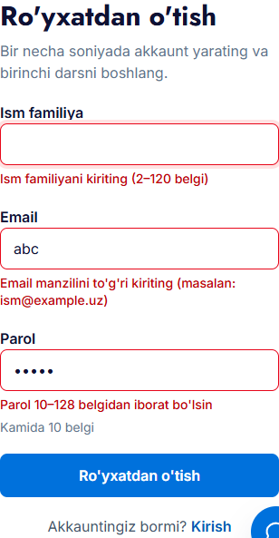

# QA hisoboti — 2026-10-23

Platformani qo‘lda va avtomatik tekshirish natijalari: asosiy funksiyalar, baxtli yo‘l, negativ holatlar, brauzer va qurilmalar, xavfsizlik asoslari, avtomatlashtirish.

**Muhit:** demo bazaning nusxasi (PGlite), compiled API, Next.js production build (`next start`, Next 16.4.2), sandbox origin, haqiqiy CHECK engine (Chrome). Demo bazaning o‘ziga tegilmagan. Testlar brauzerni boshqaruvchi skript (Playwright) orqali bajarilgan — har bir qadam haqiqiy brauzerda bosish va yozish bilan.

## 1. Asosiy funksiyalar

| #   | Funksiya                    | Foydalanuvchi nima qiladi                                     |
| --- | --------------------------- | ------------------------------------------------------------- |
| F1  | Ro‘yxatdan o‘tish           | Ism, email, parol → kabinet                                   |
| F2  | Kirish va chiqish           | Login/email + parol; menyu orqali chiqish                     |
| F3  | Kursga yozilish             | Kurs → yozilish → xarita; darslar ketma-ket ochiladi          |
| F4  | Mashq (IDE, RUN, CHECK)     | Kod yozish, natijani ko‘rish, rasmiy tekshiruv → dars tugaydi |
| F5  | Test                        | Savollarga javob berish → natija foizi                        |
| F6  | Portfolio                   | Manzil (slug) tanlash, ishni qo‘shish, e’lon qilish           |
| F7  | Chatbot                     | Platforma haqida savol berish                                 |
| F8  | Admin: guruhlar va hisoblar | Ro‘yxat importi, o‘qituvchi yaratish                          |

Topshiriq topshirish va baholash, guruh paneli, Excel eksport va elektron darslik avvalgi fazalarda tekshirilgan va CI’dagi E2E’da bor (`e2e/full-flow.e2e.mjs`).

## 2. Baxtli yo‘l va negativ holatlar (Chrome)

Natija: **39/39** (tuzatishlardan keyin). Birinchi o‘tishda 5 ta haqiqiy xato topildi (Q-1), qolgan farqlar skript selektorlari edi.

| ID    | Funksiya                       | Tur         | Qadamlar                                                                                        | Kutilgan natija                                                                 | Haqiqiy natija                                                                                                                                                                                                 | Holat            |
| ----- | ------------------------------ | ----------- | ----------------------------------------------------------------------------------------------- | ------------------------------------------------------------------------------- | -------------------------------------------------------------------------------------------------------------------------------------------------------------------------------------------------------------- | ---------------- |
| F1-01 | Ro'yxatdan o'tish              | baxtli yo‘l | Ism, yangi email, 10+ belgili parol → Ro'yxatdan o'tish                                         | Kabinet ochiladi, ism ko‘rinadi                                                 | Kabinet ochildi, ism ko‘rindi                                                                                                                                                                                  | ✅               |
| F1-02 | Ro'yxatdan o'tish              | xavfsizlik  | Javobdagi cookie atributlari                                                                    | Sessiya cookie HttpOnly va SameSite=Lax                                         | httpOnly=true, sameSite=Lax                                                                                                                                                                                    | ✅               |
| F1-03 | Ro'yxatdan o'tish              | negativ     | Hamma maydon bo‘sh                                                                              | Faqat xato maydon(lar) belgilanadi: fullName, email, password; o‘z xabari bilan | belgilangan: fullName, email, password; fokus: fullName; xabarlar: "Ism familiyani kiriting (2–120 belgi) / Email manzilini to'g'ri kiriting (masalan: ism@example.uz) / Parol 10–128 belgidan iborat bo'lsin" | ✅               |
| F1-04 | Ro'yxatdan o'tish              | negativ     | Ism bo‘sh, email va parol to‘g‘ri                                                               | Faqat xato maydon(lar) belgilanadi: fullName; o‘z xabari bilan                  | belgilangan: fullName; fokus: fullName; xabarlar: "Ism familiyani kiriting (2–120 belgi)"                                                                                                                      | ✅               |
| F1-05 | Ro'yxatdan o'tish              | negativ     | Email noto‘g‘ri ("abc"), qolgani to‘g‘ri                                                        | Faqat xato maydon(lar) belgilanadi: email; o‘z xabari bilan                     | belgilangan: email; fokus: email; xabarlar: "Email manzilini to'g'ri kiriting (masalan: ism@example.uz)"                                                                                                       | ✅               |
| F1-06 | Ro'yxatdan o'tish              | negativ     | Parol 5 belgi                                                                                   | Faqat xato maydon(lar) belgilanadi: password; o‘z xabari bilan                  | belgilangan: password; fokus: password; xabarlar: "Parol 10–128 belgidan iborat bo'lsin"                                                                                                                       | ✅               |
| F1-07 | Ro'yxatdan o'tish              | negativ     | Ism maydoniga 5000 belgi yozish                                                                 | Maydon 120 belgidan oshirmaydi                                                  | 120 belgi qoldi                                                                                                                                                                                                | ✅               |
| F1-08 | Ro'yxatdan o'tish              | negativ     | Band email bilan (F1-01 dagi)                                                                   | Tushunarli xabar, 500 emas                                                      | "Bu email bilan ro'yxatdan o'tib bo'lmaydi"                                                                                                                                                                    | ✅               |
| F1-09 | Ro'yxatdan o'tish              | negativ     | Ism: "'; DROP TABLE users;--                                        | Ro‘yxatdan o‘tadi, ism oddiy matn bo‘lib chiqadi, skript ishlamaydi             | alert oynalari: 0, : 0                                                                                                                                                                              | ✅               |
| F1-10 | Ro'yxatdan o'tish              | negativ     | Internet uzilgan holda yuborish                                                                 | "Server bilan aloqa yo‘q" xabari, sahifa buzilmaydi                             | "Server bilan aloqa yo'q. Internetni tekshirib, qayta urinib ko'ring", tugma faol: true                                                                                                                        | ✅               |
| F2-01 | Kirish                         | negativ     | Mavjud email + noto‘g‘ri parol                                                                  | Neytral xato xabari                                                             | "Login yoki parol noto'g'ri"                                                                                                                                                                                   | ✅               |
| F2-02 | Kirish                         | xavfsizlik  | Mavjud bo‘lmagan email + parol                                                                  | Xuddi F2-01 bilan bir xil xabar (email borligi oshkor bo‘lmaydi)                | "Login yoki parol noto'g'ri"                                                                                                                                                                                   | ✅               |
| F2-03 | Kirish                         | negativ     | Bo‘sh login va parol                                                                            | Xabar, serverga so‘rov ketmaydi                                                 | "Login (yoki email) va parolni to'g'ri kiriting"                                                                                                                                                               | ✅               |
| F2-04 | Kirish                         | negativ     | Parol 500 belgi                                                                                 | Tushunarli xabar, 500 emas                                                      | "Login (yoki email) va parolni to'g'ri kiriting"                                                                                                                                                               | ✅               |
| F2-05 | Kirish                         | xavfsizlik  | Bitta akkauntga ketma-ket 6 marta noto‘g‘ri parol                                               | 5 tadan keyin bloklanadi (429, "ko‘p urinish")                                  | 6-urinish: "Juda ko'p urinish. Birozdan keyin qayta urinib ko'ring"                                                                                                                                            | ✅               |
| F2-06 | Kirish                         | baxtli yo‘l | To‘g‘ri email va parol (F1-01 akkaunti)                                                         | Kabinet ochiladi                                                                | Kabinet ochildi                                                                                                                                                                                                | ✅               |
| F2-07 | Chiqish                        | baxtli yo‘l | Menyu → Chiqish → tasdiqlash, so‘ng "Orqaga"                                                    | Bosh sahifa; sessiya o‘chadi; Orqaga bosilsa login sahifasi                     | /auth/me → 401, Orqaga → /login                                                                                                                                                                                | ✅               |
| F3-01 | Kursga yozilish                | baxtli yo‘l | Kabinet → "HTML: to‘liq kurs" → Kursga yozilish                                                 | Xarita: 1-dars ochiq, 2-dars yopiq                                              | 1-dars AVAILABLE, 2-dars LOCKED                                                                                                                                                                                | ✅               |
| F3-02 | Ketma-ket ochilish             | negativ     | 2-dars manzilini to‘g‘ridan-to‘g‘ri ochish                                                      | Dars matni ko‘rsatilmaydi, "yopiq" holati                                       | sahifa: yopiq holat; API 403 LESSON_LOCKED                                                                                                                                                                     | ✅               |
| F4-01 | Mashq (RUN)                    | baxtli yo‘l | Mashqni ochish → kod yozish → Ishga tushirish                                                   | Preview natijani ko‘rsatadi                                                     | Preview’da "Sinov sarlavha" ko‘rindi                                                                                                                                                                           | ✅               |
| F4-02 | Mashq (CHECK)                  | negativ     | Noto‘liq kod bilan Tekshirish                                                                   | FAILED va tushunarli maslahat; mashq o‘tilmaydi                                 | FAILED natija paneli chiqdi                                                                                                                                                                                    | ✅               |
| F4-03 | Mashq (CHECK)                  | baxtli yo‘l | To‘g‘ri yechim → Tekshirish                                                                     | PASSED; 1-dars tugaydi, 2-dars ochiladi                                         | 1-dars COMPLETED, 2-dars AVAILABLE                                                                                                                                                                             | ✅               |
| F4-04 | Mashq (saqlash)                | negativ     | Internet uzilgan holda kodni o‘zgartirib Saqlash                                                | Xato xabari; internet qaytgach saqlash ishlaydi                                 | oflayn: "Server bilan aloqa yo'q. Internetni tekshirib, qayta urinib ko'ring"; onlayn: Saqlangan                                                                                                               | ✅               |
| F4-05 | Mashq (xavfsizlik)             | xavfsizlik  | Kodda document.cookie va parent DOM’ga murojaat → RUN                                           | Kod sandbox ichida qoladi: cookie va platforma sahifasiga yetib bo‘lmaydi       | cookie=bloklandi                                                                                                                                                                                               | parent=bloklandi | ✅  |
| F5-01 | Test                           | negativ     | Testni hech narsa belgilamasdan yuborish                                                        | Tasdiq oynasi so‘raydi; "Bekor qilish" urinishni yubormaydi                     | oyna: "Testni yuborish Hamma savolga javob berilmagan. Baribir yuborasizmi? Bekor qilis…", bekor qilindi                                                                                                       | ✅               |
| F5-02 | Test                           | baxtli yo‘l | Barcha savollarga javob berib yuborish                                                          | Natija foizi ko‘rsatiladi, qaysi javob to‘g‘riligi oshkor bo‘lmaydi             | "Oxirgi urinish: 0% (0 / 2 to'g'ri) — o‘tilmadi Test bajarildi. Xohlasangiz yana mashq qilishingiz mumkin, natija saqlani"                                                                                     | ✅               |
| S-01  | Boshqa foydalanuvchi ma’lumoti | xavfsizlik  | QA talabasi Aziza’ning portfolio ishini ID bo‘yicha so‘raydi                                    | 404 (ma’lumot berilmaydi)                                                       | 404                                                                                                                                                                                                            | ✅               |
| S-02  | Boshqa foydalanuvchi ma’lumoti | xavfsizlik  | QA talabasi Aziza’ning mashq workspace’ini va CHECK natijasini so‘raydi (soxta x-user-id bilan) | Faqat o‘z ma’lumotini oladi                                                     | 200, Aziza ma’lumoti: yo‘q                                                                                                                                                                                     | ✅               |
| S-03  | Rol cheklovi                   | xavfsizlik  | Talaba admin va guruh paneli API’larini chaqiradi                                               | 403                                                                             | 403, 403, 403                                                                                                                                                                                                  | ✅               |
| S-04  | Rol cheklovi                   | xavfsizlik  | Talaba admin sahifasini brauzerda ochadi                                                        | "Ruxsat yo‘q" holati, ma’lumot yo‘q                                             | Ruxsat yo‘q holati ko‘rsatildi                                                                                                                                                                                 | ✅               |
| F6-01 | Portfolio                      | negativ     | Manzilga "Mening Portfoliom!!" kiritib saqlash                                                  | Kichik harf/defisga normallashadi yoki aniq xato                                | qiymat "Mening Portfoliom!!", xabar "Manzil 3–40 ta kichik lotin harfi, raqam va chiziqchadan iborat bo‘lsin"                                                                                                  | ✅               |
| F6-02 | Portfolio                      | negativ     | Band manzil "aziza-karimova"                                                                    | "Bu manzil band" xabari                                                         | "Bu manzil band"                                                                                                                                                                                               | ✅               |
| F7-01 | Chatbot                        | baxtli yo‘l | Bosh sahifa → chat tugmasi → "Qanday ro‘yxatdan o‘taman?"                                       | Javob va havola chiqadi                                                         | Javob chiqdi                                                                                                                                                                                                   | ✅               |
| F7-02 | Chatbot                        | negativ     | Bo‘sh xabar yuborish                                                                            | Yuborilmaydi                                                                    | xabarlar soni 1 → 1                                                                                                                                                                                            | ✅               |
| F7-03 | Chatbot                        | negativ     | 2000 belgilik xabar                                                                             | Cheklanadi (maxlength) yoki tushunarli xabar, sahifa buzilmaydi                 | maydonga kirgan: 500 belgi, xato xabari: 0                                                                                                                                                                     | ✅               |
| F7-04 | Chatbot                        | negativ     | Xabar:                                                                 | Oddiy matn sifatida chiqadi, skript ishlamaydi                                  | matn ko‘rindi, alert: 0                                                                                                                                                                                        | ✅               |
| F8-01 | Admin: ro‘yxat importi         | negativ     | Import maydoniga tartibsiz matn → Ko‘rib chiqish                                                | Aniq xabar, hech narsa yaratilmaydi                                             | "Talabasiz guruh: salom dunyo 12345 !!!."                                                                                                                                                                      | ✅               |
| F8-02 | Admin: o‘qituvchi yaratish     | negativ     | Bo‘sh forma → O‘qituvchi yaratish                                                               | Aniq xabar                                                                      | "F.I.Sh. (kamida 3 belgi), login (lotin harflari, raqam, nuqta yoki chiziqcha) va to‘g‘ri email kiriting."                                                                                                     | ✅               |
| F8-03 | Admin: guruhlar                | baxtli yo‘l | Guruhlar sahifasi                                                                               | 3 guruh, jami 74 talaba                                                         | 3 guruh ko‘rindi                                                                                                                                                                                               | ✅               |

## 3. Topilgan xatolar

| ID  | Qadamlar                                                                                          | Kutilgan natija                | Haqiqiy natija                                                                                              | Holat                                                      |
| --- | ------------------------------------------------------------------------------------------------- | ------------------------------ | ----------------------------------------------------------------------------------------------------------- | ---------------------------------------------------------- |
| Q-1 | `/register`: ism bo‘sh (yoki email “abc”, yoki ism 5000 belgi), parol to‘g‘ri → Ro‘yxatdan o‘tish | Xato maydon haqida aniq xabar  | Har doim “Ma’lumotlarni tekshiring: **parol** kamida 10 belgidan iborat bo‘lsin” — parol to‘g‘ri bo‘lsa ham | ✅ Tuzatildi                                               |
| Q-2 | Xuddi shu forma, xato maydon                                                                      | Xato maydon ko‘zga tashlanadi  | Maydon chegarasi oddiy rangda qoladi                                                                        | ✅ Tuzatildi                                               |
| Q-3 | WebKit (Safari dvigateli, Windows build) — istalgan sahifa                                        | Sarlavha, logo, tugmalar qalin | Hammasi oddiy qalinlikda (Inter/Jost variable shriftlari)                                                   | ⚠️ Tasdiqlanmagan — haqiqiy iPhone/Mac’da tekshirish kerak |
| Q-4 | GitHub Actions, `e2e` job (Ubuntu), run 39937542022                                               | E2E o‘tadi                     | `pnpm e2e` exit 1; lokal (Windows) 55/55                                                                    | ⚠️ Ochiq — log kerak                                       |

**Q-1 tuzatish:** har bir xato maydon o‘z xabarini oladi (“Ism familiyani kiriting (2–120 belgi)”, “Email manzilini to‘g‘ri kiriting…”, “Parol 10–128 belgidan…”), `aria-invalid` va `aria-describedby` bilan bog‘lanadi, fokus birinchi xato maydonga o‘tadi; ism maydoni 120 belgidan oshmaydi (`maxLength`). Kod: `apps/web/src/lib/register-errors.ts`, `components/auth-form.tsx`.

**Q-2 tuzatish:** `.field[aria-invalid='true']` — qizil chegara va fokus halqasi (yorug‘ va qorong‘i rejim). Chatbotning aloqa formasi ham shundan foydalanadi.

**Q-3:** oddiy (statik) shriftda qalin matn shu WebKit’da to‘g‘ri chiqadi, faqat variable shrift qalinligi qo‘llanmaydi. Haqiqiy Safari variable shriftlarni 11-versiyadan beri qo‘llaydi, shuning uchun bu Windows’dagi WebKit build’ining cheklovi bo‘lishi ehtimoli katta. Haqiqiy qurilmada ko‘rilmaguncha yopilmaydi.

**Q-4:** job loglari faqat repo admini uchun ochiq (API 403). Lokal muhitda takrorlanmaydi.

### Kuzatuvlar (xato emas)

- Hamma brauzerlar bitta IP’dan ishlaganda ochiq sahifalar limiti (daqiqasiga 120) ishladi — kutilgan himoya. Limitga tushgan mehmon “Sahifani yuklab bo‘lmadi” sahifasini “Qayta urinish” tugmasi bilan ko‘radi; 5xx xato 0 ta.
- `/yonalishlar` va bosh sahifadagi yo‘nalish kartalari Next.js tomonidan oldindan yuklanadi (prefetch) — har bir ochishda ~10 ta qo‘shimcha API so‘rovi. Oddiy foydalanuvchi limitga yetmaydi, lekin yuklamani kamaytirish uchun `prefetch={false}` ko‘rib chiqilishi mumkin.
- WebKit’da bitta marta “access control checks” xabari: login’dan keyingi navigatsiya paytida bekor qilingan `/auth/me` so‘rovi. `api()` uni ushlaydi, sahifa to‘g‘ri chiqadi; qayta urinishda takrorlanmadi.
- Javobsiz testni yuborishda tasdiq oynasi chiqadi (“Hamma savolga javob berilmagan…”) — ataylab qilingan xatti-harakat.

## 4. Brauzer va qurilmalar

Har kombinatsiyada 13 ta tekshiruv: 4 ta ochiq sahifa, forma orqali kirish, kabinet, kurs xaritasi, dars, natijalar, portfolio, elektron darslik, mashq IDE’si va RUN (sandbox preview). Har sahifada: HTTP holati, gorizontal scroll yo‘qligi, ushlanmagan JS xatosi yo‘qligi.

| Brauzer                    | Telefon 390×844 | Planshet 768×1024 | Desktop 1440×900 |
| -------------------------- | --------------- | ----------------- | ---------------- |
| Chrome 155                 | 13/13           | 13/13             | 13/13            |
| Edge 155                   | 13/13           | 13/13             | 12/13 ¹          |
| Firefox (Playwright build) | 13/13           | 13/13             | 13/13            |
| WebKit (Safari dvigateli)  | 13/13           | 13/13             | 12/13 ²          |

¹ Ochiq sahifalar IP limiti (yuqoridagi kuzatuv); alohida 5 marta qayta ochilganda 5/5.
² Bekor qilingan so‘rov xabari (yuqoridagi kuzatuv); takrorlanmadi.

**Tekshirilmagan:** haqiqiy Safari (macOS/iOS) va haqiqiy telefonlar — Windows’da Safari yo‘q, telefonlar emulyatsiya (o‘lcham, sensor, `isMobile`) bilan sinaldi.

## 5. Xavfsizlik asoslari

| Tekshiruv                      | Natija                                                                                                                                                |
| ------------------------------ | ----------------------------------------------------------------------------------------------------------------------------------------------------- |
| Boshqa foydalanuvchi ma’lumoti | Begona portfolio ishi 404; soxta `x-user-id`/`x-role` bilan faqat o‘z ma’lumoti (S-01, S-02)                                                          |
| Rol cheklovi                   | Talabaga admin, guruh paneli va tashkilot analitikasi 403, sahifada “Ruxsat yo‘q” (S-03, S-04)                                                        |
| Parollar shifrlanganmi         | Argon2id (`m=19456, t=2, p=1`); sinov paroli bazaning 38 jadvalining hech birida va API logida ochiq ko‘rinishda yo‘q; sessiya tokeni 64 belgili xesh |
| Login’ni qayta-qayta urinish   | 6-urinishda “Juda ko‘p urinish…” (429) (F2-05)                                                                                                        |
| Email borligini bilib olish    | Noto‘g‘ri parol va mavjud bo‘lmagan email — bir xil xabar (F2-02)                                                                                     |
| Cookie                         | `HttpOnly`, `SameSite=Lax` (F1-02); production’da `Secure` (avvalgi testlar)                                                                          |
| XSS (ism, chatbot)             | Matn sifatida chiqadi, skript ishlamaydi (F1-09, F7-04)                                                                                               |
| Talaba kodi (sandbox)          | `document.cookie` va platforma sahifasiga kirish bloklangan (F4-05)                                                                                   |
| Chiqishdan keyin “Orqaga”      | Login sahifasi, kabinet ma’lumoti ko‘rinmaydi (F2-07)                                                                                                 |

## 6. Avtomatlashtirish

Takrorlanadigan testlar har o‘zgarishdan keyin CI’da ishlaydi:

- **Unit + integratsion:** 570 ta (`pnpm -r test`) — avtorizatsiya, IDOR, limitlar, validatsiya, CHECK, AI va boshqalar.
- **To‘liq E2E** (`pnpm e2e`, haqiqiy brauzer): 55 qadam. Shu tekshiruvda qo‘shildi:
  - ro‘yxatdan o‘tishda faqat xato maydonlar belgilanadi va fokus birinchisiga o‘tadi;
  - ism maydoni 120 belgidan oshmaydi;
  - internet uzilganda “Server bilan aloqa yo‘q” xabari;
  - noto‘g‘ri parol va mavjud bo‘lmagan akkaunt — bir xil xabar.
- **Sandbox xavfsizlik E2E** (`pnpm --filter @webdizayn/sandbox e2e`): 24 ta.
- `register-errors.test.ts` — har maydon uchun xabar (3 ta test).

Bu hisobotdagi qo‘lda-tekshiruv skriptlari demo bazaning ID’lariga bog‘liq, shuning uchun repoga qo‘shilmadi; ularning barqaror qismi E2E’ga ko‘chirildi.

## 7. Keyingi qadamlar

1. Q-4: GitHub’dagi `e2e` job logini (yoki `e2e-artifacts`) olish va Ubuntu’dagi xatoni tuzatish.
2. Q-3: haqiqiy iPhone/Mac Safari’da sarlavhalar qalinligini ko‘rish.
3. Haqiqiy Android telefonda asosiy oqim (kirish → mashq → RUN → CHECK).
4. Lighthouse (unumdorlik, CLS) o‘lchovi — hali qilinmagan.
